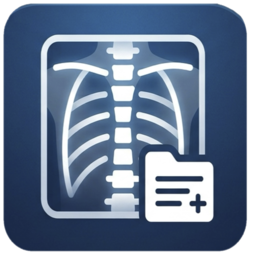

  

<h1 align="center">RadCase Manager</h1>

  Catalogue de cas radiologiques partagé, sans serveur ni cloud.

  
  
  

RadCase Manager permet à une équipe de radiologues de constituer et de consulter
ensemble une bibliothèque de cas cliniques. On colle une capture d'écran du PACS,
on décrit le cas, il rejoint le catalogue partagé du service — et il est
immédiatement visible des collègues.

## Ce qu'il fait

- **Coller et enregistrer** : `Ctrl+V` dans *Nouveau cas*, un titre, une
  description, des unités, et c'est catalogué.
- **Dossier partagé** : chaque cas est un dossier autonome (image +
  description) dans le dossier réseau du service. Pas de serveur, pas de base de
  données, pas de compte à créer.
- **Fil d'actualité** : les derniers cas des unités que vous suivez, avec une
  pastille quand du nouveau arrive.
- **Bibliothèque** : liste triable par titre ou par date ; le cas sélectionné
  s'affiche à droite, image cliquable pour le plein écran et informations
  complètes.
- **Recherche avancée** : unités, auteur, période, type de cas, texte ; export
  CSV / Excel des résultats.
- **Lecture du texte des images** : le numéro de demande est reconnu **sur le
  poste**, à l'enregistrement — aucun envoi sur Internet.
- **Réactions anonymes** : un emoji par cas et par personne, seuls les compteurs
  sont affichés, jamais les noms.

## Installation

1. Téléchargez `RadCaseManager.exe` dans les
   [Releases](https://github.com/gfahrni/radcase-manager/releases/latest).
2. Posez-le où vous voulez — le Bureau convient.
3. Double-cliquez.

Rien à installer, aucun droit administrateur. Windows 10 ou 11, 64 bits :
l'application est un fichier unique, ses réglages restent sur le poste.

> Windows peut afficher un avertissement au premier lancement (exécutable non
> signé) : *Informations complémentaires* → *Exécuter quand même*.

## Premier lancement

- Le **nom d'auteur** est repris du compte Windows de la session.
- Choisissez le **dossier partagé** du service (sur un poste préparé, le chemin
  est déjà proposé).
- Les réglages sont enregistrés **sur ce poste uniquement**, jamais dans le
  dossier partagé : deux personnes peuvent utiliser le même `.exe` sans
  partager leurs préférences.

## Utilisation

| Onglet | À quoi ça sert |
|---|---|
| ➕ **Nouveau cas** | Coller l'image, décrire, choisir les unités, enregistrer. |
| ⚪ **Fil d'actualité** | Les derniers cas des unités suivies ; les cas non lus sont surlignés. |
| 📖 **Bibliothèque** | Tous les cas, par unité, triables par titre ou par date ; détail à droite. |
| 🔎 **Recherche avancée** | Recherche multi-critères et export des résultats. |

Gestes courants :

- `Ctrl+V` importe l'image du presse-papiers.
- Un **clic** sur une image l'ouvre en plein écran (`Échap` ferme).
- Un **clic droit** sur un cas permet de le modifier ou de le supprimer : le
  vôtre dans le Fil et la Bibliothèque, n'importe lequel dans la Recherche
  avancée.
- La **recherche rapide** de la Bibliothèque filtre par titre au fil de la
  frappe.

## Vie de l'application

- Fermer la fenêtre **réduit** l'application dans la zone de notification ;
  « Quitter » l'arrête vraiment.
- Elle peut **démarrer avec Windows**, réduite, prête à recevoir une image.
- Elle se **met à jour toute seule** depuis GitHub, en tâche de fond (une fois
  par jour au plus) : rien à télécharger à la main.
- **Un seul lancement à la fois** : relancer l'exécutable ramène simplement la
  fenêtre existante.

## Où sont mes données ?

Dans le **dossier partagé** choisi au premier lancement : c'est lui qui contient
les cas, et rien ne les recopie ailleurs. L'application n'envoie aucune donnée
patient sur Internet — la seule connexion sortante sert à vérifier les mises à
jour. Les réglages, l'index de recherche et les vignettes restent dans le profil
Windows du poste.

## Problèmes courants

- **« Dossier introuvable »** : le partage réseau n'est pas monté, ou le chemin a
  changé → *Fichier → Réglages…*.
- **Pas de numéro de demande détecté** : l'OCR de Windows n'est pas installé, ou
  l'image est trop floue / trop petite ; le champ reste modifiable dans l'onglet
  Édition.
- **Une mise à jour a échoué** : relancez l'application, la nouvelle version
  sera proposée à nouveau.

## Développement

- Installation, build du `.exe`, tests : [DEVELOPMENT.md](DEVELOPMENT.md)
- Architecture et choix techniques : [ARCHITECTURE_PLAN.md](ARCHITECTURE_PLAN.md)
- Mises à jour automatiques : [AUTO_UPDATE_PLAN.md](AUTO_UPDATE_PLAN.md)
